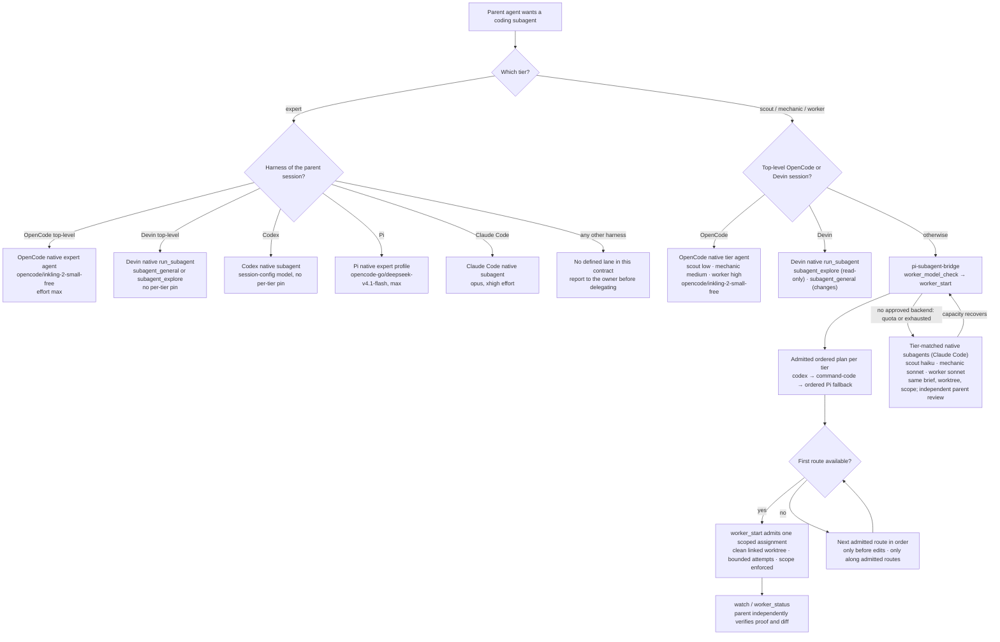

# Subagent architecture

<!-- Generated from tools/policy/subagent-visualization.ts; run make subagent-visualization. -->
<!-- Hand-edit the generator, not this file. Policy inputs come from `tools/pi-subagent-bridge/src/policy.ts` via the typed `POLICY` export. -->

Decision graph for delegating a coding subagent. Tiers: `scout` (read-only: no `bash`, `edit` or `write`), `mechanic`, `worker`, `expert`. There is no `god` tier, and the `gemini-4-argon` / `gemini-4-carbon` / `gpt-6-astra` / `gpt-6.1-astra` / `gpt-6.2-astra` families are prohibited everywhere, including every effort variant.

## Lane map

Expert is native everywhere; the bridge is reserved for `scout`/`mechanic`/`worker` in harnesses without a top-level native exception.

| Assignment | OpenCode (top-level) | Devin (top-level) | Codex | Pi | Claude Code |
| --- | --- | --- | --- | --- | --- |
| expert | native `expert` agent (`opencode/inkling-2-small-free#max`) | `run_subagent`, unpinned | native subagent, unpinned | native `expert` profile (`opencode-go/deepseek-v4.1-flash`, `max`) | native subagent (`opus`, `xhigh` effort) |
| quota exhaustion (scout/mechanic/worker) | never uses the bridge | never uses the bridge | not defined; report rather than substitute | not defined; report rather than substitute | native subagents: `scout` `haiku` · `mechanic` `sonnet` · `worker` `sonnet`, same brief, worktree and scope |

Codex, Pi and Claude Code route `scout`/`mechanic`/`worker` through the bridge; the admitted routes are:

## The bridge, per tier

| Tier | Primary | Fallback (in order) |
| --- | --- | --- |
| scout | Codex `gpt-6-luna` (`medium`) | Command Code `meta/muse-ember` (`medium`); Pi `opencode-go/muse-spark-1.3-contributor` (`medium`) |
| mechanic | Codex `gpt-6-luna` (`high`) | Command Code `meta/muse-ember` (`xhigh`); Pi `opencode-go/muse-spark-1.3-contributor` (`high`) |
| worker | Codex `gpt-6.1-terra` (`high`) | Command Code `deepseek/deepseek-v4.1-flash` (`high`); Pi `muse-sdk/muse-spark-1.3` (`xhigh`); Pi `opencode-go/deepseek-v4.1-flash` (`high`); Pi `devin/swe-2-flash` (`medium`) |

## Hard rules

- The bridge admits `scout`, `mechanic`, `worker` only. `worker_model_check`, `worker_start`, resume, steer and the MCP schemas reject `expert`.
- Expert is harness-native everywhere; nothing routes to the bridge. Expert is terminal by lane: use it for exceptional architectural decisions and adversarial review, never as a size-based upgrade.
- Top-level OpenCode and Devin sessions never use the bridge, at any tier or as a fallback. When the OpenCode top-level model is free, every tier runs a free model (the configured tier agents use `opencode/inkling-2-small-free` regardless of the top-level model).
- Claude Code, Codex and Pi sessions use the bridge for `scout`/`mechanic`/`worker`; the bridge owns provider fallback (Codex → Command Code → ordered Pi), only before edits, only along admitted routes.
- An admitted session keeps its recorded model and route. A task failure, rejected acceptance check or scope change is not a provider failure and never authorizes a replacement worker.
- Codex and Command Code workers are leaves. Pi workers may fan out one nested generation to equal-or-weaker approved tiers; the typed ceiling is enforced per child, depth is 2, and `options: { agentScope: "user" }` is required for nested calls.
- Ban on delegation of `gemini-4-argon` / `gemini-4-carbon` / `gpt-6-astra` / `gpt-6.1-astra` / `gpt-6.2-astra` families in every harness, including every effort variant.
- The parent owns scope, worktrees, verification and integration in every harness. Agent output is a claim until the parent checks the diff and the acceptance proof.

See [orchestrate](../dotfiles/base/.agents/skills/orchestrate/SKILL.md) for the routing contract and [the bridge reference](../tools/pi-subagent-bridge/README.md) for admission, fallback and state semantics.
