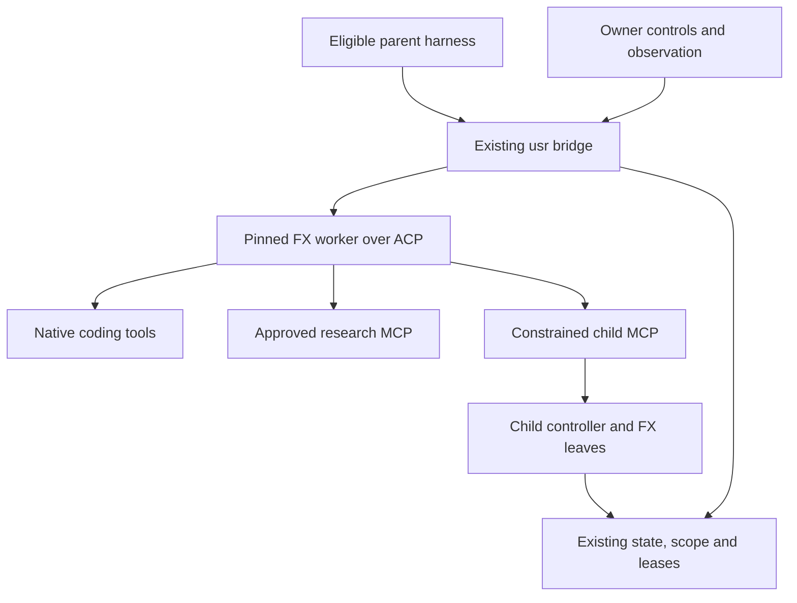

# FX headless-worker parity audit

**Date:** November 19, 2026 (America/Los_Angeles)

**Decision:** Proceed with a bounded migration campaign. Preserve the existing `usr` bridge and qualify FX's native ACP interface as its worker runtime. The current FX experiment is not a PI replacement yet.

**Scope:** Source audit, primary documentation, offline adapter tests, focused failure-recovery reproductions, and a released-binary ACP handshake. The audit performed no runtime/configuration changes, provider logins, live inference, rollout, or PI removal.

This is dated evidence. The [runtime-independence and FX campaign](../roadmap.md#campaign-runtime-independent-worker-bridge-and-fx) is the authoritative remaining execution plan. Its documentation integration refreshed usr to `41c91c0fff525226407c7f809015f6a29fc0154f`; intervening changes from the audit baseline only affected skill/test guidance, leaving the inspected bridge inputs unchanged.

## 1. Executive assessment

FX is a credible replacement for PI's role as a headless worker engine. Most of the orchestration that matters already belongs to `usr`: admission, immutable route snapshots, worktree ownership, attempts, acceptance-claim parsing and Git scope checks, observation, owner receipts, and failover. The parent independently executes or verifies acceptance proof. Retain that machinery. Building a separate orchestration implementation called `fx-subagent-bridge` would duplicate the hardest and most mature part of the system.

The FX experiment has not simply been abandoned. It already uses the shared state machine, and the November 17 steering-recovery change updated `fx.ts` to participate in planned relaunches. However, its intentional pilot restrictions and several uncovered lifecycle gaps prevent parity with the current PI workers.

Three findings materially simplify the plan:

1. **The configured PI workers do not currently have dedicated web search.** `pi-web-access` is absent from the selected `pi-build` closure and from the strict worker tool allowlists. This is a desired capability, rather than an established bridge feature FX would remove. Untracked configuration on a personal machine was not inspected.
2. **`pi-web-access` now offers a standalone MCP server requiring no PI installation.** Its usable search/fetch core can be retained without retaining the PI harness.
3. **FX has an existing ACP interface with native coding tools, saved sessions, streamed tool activity, cancellation, client-supplied MCP, and a negotiated live-steering extension.** This is the best next experiment. The SDK is real and capable, but adopting it would also require hosting the coding tools and handling its Linux native-addon packaging constraints.

The difficult parity obligations are provider transports, exact model/effort enforcement, failure recovery, controlled nesting, and real task qualification. Successful FX execution on a ChatGPT route would not by itself replace the PI-dependent Muse, OpenCode Go, and Devin routes.

## 2. Audited baselines

| Component | Revision / version | Interpretation |
| --- | --- | --- |
| `joshuarli/usr` | `5657b60dc57c2d0e8acd1a50ff99fe8c1d55faaf` | Bridge and routing baseline at audit time |
| PI build adopted by `usr` | `d2f544fdd3ecc54c3809b02cd4f2fd998a2576d7`, `headless-usr` | Actual selected distribution |
| Latest `joshuarli/pi-build` | `235d3be03fc03dec6f217a3d9a2ff71a6f200c98` | Compared against the adopted revision |
| PI CLI / SDK / AI / agent core | `1.5.0` | Same source versions in adopted and latest PI build |
| `pi-subagents` | `0.87.0` | Current native delegation extension |
| `pi-muse-subscription` | `0.1.0` | Subscription transport adapter |
| `pi-devin-local` | `0.4.2` | Devin transport and catalog adapter |
| FX experiment | `0.0.17`, source `d1d4a883382daf8f2e7447dc361978312cf403d2` | Latest stable release found; existing pin remains relevant |
| FX upstream development HEAD | `5960bc93d435d4d9ee1c9ef7e49d9ade35f9782d` | Examined separately; not treated as released behavior |
| Standalone `pi-web-access` | `0.48.0`, source `438e58be6307efb7cd539af3806757abe303aa0c` | Proposed independent research-tool dependency |

Comparing the adopted PI build with latest HEAD found unchanged upstream versions, preserved source snapshots, and headless-profile transformation. The newer commits mainly concern build/release hardening, tests, Windows removal and repacking, CLI help, and documentation. A newer PI-build commit alone does not imply new runtime feature requirements.

Relevant sources: [usr runtime pin](https://github.com/joshuarli/usr/blob/5657b60dc57c2d0e8acd1a50ff99fe8c1d55faaf/tools/pi/runtime.pin.json), [PI upstream inventory](https://github.com/joshuarli/pi-build/blob/235d3be03fc03dec6f217a3d9a2ff71a6f200c98/sources/upstreams.json), [FX experiment pin](https://github.com/joshuarli/usr/blob/5657b60dc57c2d0e8acd1a50ff99fe8c1d55faaf/tools/pi-subagent-bridge/experiment/fx/pin.json).

## 3. Feature-parity matrix

“Shared” means implemented through the existing bridge; it is not a claim that every behavior has been freshly qualified with a real FX model.

| Capability | Current PI path | Current FX experiment | Required action |
| --- | --- | --- | --- |
| Headless file read/edit and shell execution | Available | Real native tools previously qualified with a deterministic provider | Retain native FX tools; qualify realistic tasks |
| Public CLI/MCP, scoped admission, worktree lease | Implemented in `usr` | Shared | Reuse the existing implementation |
| Route snapshots and pre-edit provider failover | Implemented in `usr` | Shared; quota exhaustion/watch tested | Keep requested runtime and actual completing runtime distinct |
| Owner controls and replay receipts | Implemented in `usr` | Shared; earlier real-binary owner pilot exists | Repeat targeted new-transport controls on supported hosts |
| Successful same-session correction | Native PI resume | Qualified for valid successful FX receipts | Preserve exact session/worktree/pins |
| Resume after verified timeout/cancellation | PI retains child run/session identity | Reproduced refusal despite surviving native session | Separate continuation identity from successful completion |
| Live steering | Native RPC with delivered/queued semantics | Interrupt, terminate, and resume | Qualify ACP steering and map delivery receipts explicitly |
| Long-running job budgets | Explicit four-hour PI deadline | At most 15 minutes and 20 model steps | Separate experiment budgets from production contract |
| Deadline telemetry | Reports effective PI deadline | Reports `null` despite enforcing a deadline | Persist and report actual runtime budget |
| Exact provider/model/effort | Typed route plus native guard/preflight | Requested selection is recorded; limited effective-wire proof | Validate capabilities and retries per route |
| One nested generation, equal-or-weaker tiers | Code-enforced policy and required child extension | Native fanout denied | Implement narrow child controller with inherited authority |
| Dedicated web research | Absent from configured scoped workers | Denied/not wired | Add standalone research MCP tools as an explicit feature |
| OpenCode Go DeepSeek | Existing approved PI worker route | Auth/protocol reached real endpoint; recorded quota blocked inference | First live PI-dependent replacement candidate |
| Contributor Spark scout/mechanic | Existing PI Go routes | Not qualified by DeepSeek-only pilot | Separate route/effort/tool qualification |
| Muse subscription | Dedicated SDK/serve adapter | No equivalent configured FX transport | Port/replace transport or retain PI for this route |
| Devin SWE-2 Flash medium | Dedicated CLI-auth/catalog/stream adapter | No equivalent configured FX transport | Preserve catalog/variant/replay semantics in a replacement |
| Long context and compaction | PI child runtime supports it | FX engine supports it; bridge workload parity unqualified | Run context-pressure and recovery scenarios |
| macOS ARM64 | Selected PI distribution | Existing FX experiment qualified locally | Extend evidence through new adapter |
| Linux musl x86-64 / ARM64 | Selected PI distributions | Experiment installer rejects Linux | Pin and qualify native FX artifacts per architecture |
| Remove all PI distribution files | Also affects companion packaging | Not addressed | Migrate remaining packaging consumers separately |

Source map: [FX adapter](https://github.com/joshuarli/usr/blob/5657b60dc57c2d0e8acd1a50ff99fe8c1d55faaf/tools/pi-subagent-bridge/src/fx.ts), [shared lifecycle](https://github.com/joshuarli/usr/blob/5657b60dc57c2d0e8acd1a50ff99fe8c1d55faaf/tools/pi-subagent-bridge/src/hybrid.ts), [typed tier policy](https://github.com/joshuarli/usr/blob/5657b60dc57c2d0e8acd1a50ff99fe8c1d55faaf/tools/pi-subagent-bridge/src/tier-policy.ts), [existing FX evidence](https://github.com/joshuarli/usr/blob/5657b60dc57c2d0e8acd1a50ff99fe8c1d55faaf/docs/verification/runtime-independence-fx.md).

## 4. Concrete defects and drift

### 4.1 Recovery identity is coupled to successful final output

`fxResult()` attaches a resumable token only after successful final JSON matches the saved native session, model and workspace. Deadline and nonzero exits return an error without `sessionId`; cancellation returns an interrupted state without a result. The generic resume path then refuses them. This loses usable continuation identity even when the native session is still valid.

Two deterministic scenarios exercised the actual shared bridge and actual process supervisor with a fake FX executable:

| Scenario | Supervisor receipt | Saved FX session remains valid | Bridge resume result |
| --- | --- | --- | --- |
| One-second deadline | `deadline` | Yes | `No resumable Command Code session` |
| Explicit cancellation | `cancelled` | Yes | `Command Code run not known complete` |

The error text also exposes executor-specific wording in the shared path. The meaningful defect is the lost continuation, not the wording.

**Repair:** represent completion outcome and durable session identity independently. Verified termination can preserve a validated session token without becoming success. Unknown process termination, corrupt records, changed pins, or mismatched worktrees must still block continuation. A cancelled or timed-out worker must not trigger an automatic replacement model or replay.

Relevant code: [FX result handling](../../tools/pi-subagent-bridge/src/fx.ts), [shared resume path](../../tools/pi-subagent-bridge/src/hybrid.ts), [native delegation](../../tools/pi-subagent-bridge/src/native-delegation.ts), and [Pi port](../../tools/pi-subagent-bridge/src/pi-port.ts). The source-map links above pin the audit revision.

### 4.2 Deadline reporting is incorrect, and experiment budgets are not worker parity

The same scenarios returned `run_deadline_ms: null` at both admission and status. The helper in `hybrid.ts` reports a deadline only for PI. FX nevertheless enforces its supervisor wall budget.

PI now has a four-hour deadline. FX still has a 15-minute maximum and a 20-step limit configured independently in environment, settings, and command-line overrides. These were reasonable qualification bounds; they do not fit the same long-running-worker contract.

**Repair:** persist a runtime-neutral budget in each new admission, report it, and distinguish `timed_out`, step-budget exhaustion/incomplete, cancellation, quota, task failure, and unknown termination. Historical records remain readable without inventing budgets. Keep bounded pilots small; apply the approved production budget only after qualification.

### 4.3 Not all later bridge fixes need to be ported

The November 17 relaunch-recovery commit already changed FX to use planned output paths, planned start time, and shared steering deadlines. Later acceptance, attempt-extension, observation, and policy behavior largely resides in the shared lifecycle. The right work is targeted drift verification, not copying the latest PI bridge into a second implementation.

The earlier campaign contained historical language about exclusive experts and Antigravity adapters, while current policy makes experts harness-native and top-level Antigravity/Command Code native-only. The revised campaign preserves those decisions, records completed work, and makes recovery and ACP the next slices.

### 4.4 Effective effort must be a transport contract

The FX adapter checks the binary digest/version and requested provider, but its final receipt does not attest effective reasoning effort. A requested model/effort snapshot is necessary but insufficient.

Pinned FX source permits CLI effort omission when metadata does not support the named effort. It can also lower effort to `low` during a particular empty, length-limited response retry when that effort is advertised. This is **not a demonstrated downgrade in the existing Go pilot**: that pilot declares only `high`, so the lower-effort branch is unavailable there.

ACP rejects unsupported startup efforts. A released-binary probe confirmed rejection of `medium` when fixture metadata advertised only `high`. The production integration should generate route-specific metadata permitting only the admitted effort where possible, check restored settings, and test retry requests. Disable helper/model work that could change route economics, or explicitly account for it.

Sources: [FX model-capability resolution](https://github.com/vercel-labs/fx/blob/d1d4a883382daf8f2e7447dc361978312cf403d2/src/core/config/model_capabilities.zig), [FX retry loop](https://github.com/vercel-labs/fx/blob/d1d4a883382daf8f2e7447dc361978312cf403d2/src/core/agent/runtime/orchestrator.zig), [current live profile](https://github.com/joshuarli/usr/blob/5657b60dc57c2d0e8acd1a50ff99fe8c1d55faaf/tools/pi-subagent-bridge/experiment/fx/live-pilot.mjs).

## 5. Web search without PI

### Existing capability versus desired capability

The selected `pi-build` includes PI, pi-subagents, Muse, Devin, and Intercom components. It does not bundle `pi-web-access`. Current `TIER_TOOLS` grants local discovery, coding, and subagent tools, but no dedicated search/fetch tools. The SDK host suppresses ambient extension discovery, and current child defaults have no extra extensions. An arbitrary shell could access the network, but that is different from a managed research tool.

### Recommended integration

Use the existing standalone `pi-web-access-mcp` implementation as a pinned, locally packaged dependency. Its four public tools are `web_search`, `fetch_content`, `get_search_content`, and `source_check`. No PI runtime is required. The standalone server does not provide PI-login ChatGPT/Kimi authentication, curator/summaries, answer/extract modes, video-frame extraction, or direct image returns. Its 50-result in-memory cache disappears when the process exits. The package requires Node 22.19 or newer; its PI peers are optional. [Standalone MCP documentation](https://github.com/nicobailon/pi-web-access/blob/438e58be6307efb7cd539af3806757abe303aa0c/README.md#use-from-other-agents-mcp).

This solves the tool implementation question; it does not automatically solve credentials, costs, or durable result handling. Start with a separately configured supported search provider. Do not assume a Muse/Devin/ChatGPT coding subscription includes search access. FX's own built-in search is Gateway/Exa based and does not establish provider-independent search on the intended custom lanes. [FX search documentation](https://fx.sh/docs/capabilities/web-search).

Proposed integration behavior:

- Package the exact MCP executable and locked dependencies ahead of time; use an absolute managed path at runtime. Avoid unpinned `npx` downloads in worker startup.
- Give a research-capable worker only these explicitly approved MCP tools. Do not inherit global/project MCP servers or coordinator Intercom credentials.
- Preserve URLs, retrieved passages, retrieval time, errors, and citations in run artifacts. Handle expired result IDs after sidecar restart explicitly.
- Use a worker-private configuration/cache location. Keep coding-model credentials separate from search-provider configuration.
- Make missing tools fail admission or report explicit capability unavailability. Do not silently call a different billable model.
- Test search followed by fetch, follow-up retrieval, cancellation, unavailable provider, oversized output, and same-session continuation after MCP restart.

Porting search/extraction into FX itself is unnecessary for the first useful result. Consider embedding the host-neutral core later only if measurement justifies removing a process.

## 6. Native ACP versus the SDK

### Recommended next step: native FX over ACP

ACP is a stdio JSON-RPC control interface. The pinned FX implementation supports session creation/load/resume, streamed messages/tool activity, cancellation, supplied MCP servers, and negotiated steering. A bridge can act as the client; an editor is not required. [FX ACP documentation](https://fx.sh/docs/using-fx/acp), [pinned implementation](https://github.com/vercel-labs/fx/blob/d1d4a883382daf8f2e7447dc361978312cf403d2/src/acp/server.zig).

Proposed topology:

The bridge remains the authority. Each worker gets a private process/configuration, fixed workspace, admitted provider/model/effort, and approved MCP set. A returned session ID is recorded as soon as admission is proven. A resume opens exactly that session and verifies its saved settings. Requests and completions are correlated by protocol identity, not by selecting the newest session directory.

Do not enable full-access mode merely to avoid interactive permission prompts: that bypasses FX's own tool rules. The unattended permission policy must explicitly allow required operations and deny others. Unexpected permission or input requests become visible blocked work. Revalidate project settings, inherited skills, MCP merging, and saved settings on load.

A steering request must remain pending until its delivery is known. Protocol acceptance and model absorption are different facts. Preserve owner command IDs and replay behavior around those transitions. A process exit while a tool is running remains potentially partial work.

The pinned interface includes `session/new`, `session/load`, `session/resume`, `session/close`, `session/list`, `session/prompt`, `session/cancel`, and `session/set_config_option`. Negotiate `agentCapabilities._meta.fx.steering` before using `_meta.fx.steer: true`. One active session/prompt per connection fits one process per worker. Client MCP stdio commands must be absolute. Profile MCP opt-in does not exclude already-approved project MCP merging, so private configuration and hostile-project fixtures remain required.

This requires a real adapter/control change: today's FX start is synchronous, shared steering interrupts/relaunches, and supervision expects bounded final JSON. Extend the runtime boundary for asynchronous admission, streamed events and live control, and adapt owned-process supervision for bidirectional ACP. Retain the shared state machine, scope checks, lease and owner journal. ACP is not a command-line substitution.

### What the SDK can do

`libfx` has `createFxAgent`, `createFxEngine`, durable sessions, prompt/resume/steer/cancel, custom JS tools, MCP adapters, checkpoints, and local persistence. Local use does not require Vercel deployment. Use the actual pinned engine/session API rather than assuming it has Pi's method shapes. [API reference](https://fx.sh/docs/lib/api), [pinned SDK declarations](https://github.com/vercel-labs/fx/blob/d1d4a883382daf8f2e7447dc361978312cf403d2/sdk/types/libfx.d.cts).

It is not a zero-work substitute for the CLI. The SDK's native backend does not enable built-in shell/file tools. Host callbacks apply to the engine root, not automatically to native descendants. Host-created child engines therefore need their own registered tools and authority. Published Linux native addons require glibc 2.34 or newer; a musl deployment needs a separately qualified addon build or WASM fallback. [Pinned SDK README](https://github.com/vercel-labs/fx/blob/d1d4a883382daf8f2e7447dc361978312cf403d2/sdk/README.md), [Node runtime documentation](https://fx.sh/docs/lib/node).

**Decision rule:** try one complete ACP vertical slice first. Adopt the SDK only if a demonstrated ACP limitation prevents the required policy/lifecycle behavior, or if owning a small coding-tool implementation is a deliberate product decision. Do not adopt both transports as parallel production implementations without a concrete need.

## 7. Replacing the needed pi-subagents behavior

The whole pi-subagents package is much larger than this use case. Its UI, workflow scripting, missions, schedules, memory systems, and external-runner features are not a requirement for the configured headless workers.

Implement only the consumed contract: async spawn, stable child identity, status/wait, completion and errors, steering, cancellation, same-session correction, usage, and constrained delegation. Keep native unrestricted FX subagents disabled initially. Give the root worker a dedicated local MCP surface calling the shared controller.

The child server is bound to a parent admission, not an arbitrary caller-supplied session ID. Its handler derives the workspace, path permissions, provider policy, and parent generation from trusted state. Model-supplied arguments cannot choose a stronger tier, a new provider, a different cwd, broader tools, new extensions, another worktree, or a higher depth limit.

Required invariants:

1. One additional generation: the scoped root worker may create allowed children; those children are leaves.
2. Equal-or-weaker tiers from the existing typed lattice, with provider-specific exceptions preserved exactly.
3. Immutable parent route snapshot; descendant choices come from that snapshot rather than current mutable policy.
4. Inherited read-only/write scope and remaining deadline; explicit concurrency and work budgets.
5. Parent/child/run IDs and command deduplication survive process restart. An uncertain spawn does not authorize a duplicate spawn.
6. Descendants remain under the root worktree lease. Root completion/cancellation cannot release it while a descendant can still write.
7. Parent cancellation propagates to children and owned tool processes, and termination is verified. Retained sessions remain available for a deliberate correction.
8. Child reports are labeled agent output. The parent independently verifies the combined diff and acceptance proof.

A one-worktree nested group needs deliberate write coordination. Preserve the current policy's semantics and add bounds; do not accidentally acquire conflicting top-level leases for each child or let concurrent children escape the root accounting. This is authorization and lifecycle control, not OS containment.

## 8. Provider parity and the actual PI-removal gate

### OpenCode Go

Start with `opencode-go/deepseek-v4.1-flash` at high effort. The existing experiment already configures an OpenAI Chat Completions connection with the required session header. Previous live runs proved authentication/wire reachability and quota handling, but no successful FX inference.

Qualify Contributor Spark scout and mechanic separately. The current DeepSeek pilot does not prove their model, transport, effort, tool, or subscription behavior. PI's bundled Go support includes several protocols; generic OpenAI compatibility is not evidence of complete provider parity. [PI protocol verifier](https://github.com/joshuarli/pi-build/blob/235d3be03fc03dec6f217a3d9a2ff71a6f200c98/tools/verify-providers.mjs).

Pinned FX CLI/ACP custom connections already support OpenAI Chat Completions, OpenAI Responses, and Anthropic Messages, with extra headers and model capability metadata. This is promising for the required Go lanes. The public SDK custom-provider wrapper is narrower and uses OpenAI Chat Completions with API-key credentials; it does not establish equivalent protocol/header/auth-refresh behavior. That is another reason to try native ACP first. [Pinned native connection schema](https://github.com/vercel-labs/fx/blob/d1d4a883382daf8f2e7447dc361978312cf403d2/src/core/config/configured_provider.zig), [SDK custom-provider implementation](https://github.com/vercel-labs/fx/blob/d1d4a883382daf8f2e7447dc361978312cf403d2/sdk/custom-provider.js).

### Muse subscription

The existing adapter uses Muse Code SDK plus `muse serve` as authenticated transport while PI owns the loop/tools. It preserves parked tool calls and native session continuity, and distinguishes subscription traffic from the metered API. A matching model label behind another endpoint is insufficient. [Bundled Muse adapter](https://github.com/joshuarli/pi-build/blob/235d3be03fc03dec6f217a3d9a2ff71a6f200c98/sources/pi-muse-subscription/README.md).

Use that adapter's host tests as the oracle for a transport extraction or native Muse executor alternative. Preserve subscription semantics, contributor setting, cancellation, tool-result correlation, context handoff, and resume/fork behavior. Leave the PI route available until the replacement passes or the owner explicitly retires that route.

### Devin

The existing integration is a custom transport with CLI authentication/catalog discovery, effort-to-variant mapping, and replay information. The current worker pin is SWE-2 Flash medium. Preserve that exact mapping and tool/reasoning state, rather than assuming an OpenAI-compatible endpoint is interchangeable. [Bundled Devin adapter](https://github.com/joshuarli/pi-build/blob/235d3be03fc03dec6f217a3d9a2ff71a6f200c98/sources/pi-devin-local/README.md).

### Current routing boundaries

Bridge tiers are scout, mechanic, and worker. Experts are harness-native. Top-level Antigravity, Command Code, OpenCode, and Devin use native children. Claude Code, Codex, and PI parents currently use the bridge for the three lower tiers. Retain these rules. FX replaces an execution component behind the bridge; it does not reopen previously settled delegation policy. [Current subagent architecture](https://github.com/joshuarli/usr/blob/5657b60dc57c2d0e8acd1a50ff99fe8c1d55faaf/docs/subagents.md).

### PI runtime removal versus distribution removal

Retiring PI from worker execution and removing the entire PI distribution are separate milestones. Intercom companion packaging and installer defaults still consume the distribution. Migrate those consumers before uninstalling anything. Preserve historical PI records for inspection; a PI session cannot silently become an FX session.

## 9. Campaign handoff

The [existing campaign](../roadmap.md#campaign-runtime-independent-worker-bridge-and-fx) now contains the authoritative sequence, ownership, prerequisites and acceptance gates. It begins with the reproduced recovery/budget defects, then qualifies one ACP worker before live route replacement, standalone research, controlled children, remaining providers/platforms, and measured retirement.

Do not build a second bridge or redo accepted runtime independence. Preserve source pins, distinguish historical evidence from fresh diagnostics, and attach unavailable account/host proof only to dependent work. The current synchronous runtime controls and root-only lease lifetime need deliberate extensions before ACP and controlled descendants can satisfy parity.

## 10. Verification performed during this audit

| Check | Result | Limit |
| --- | --- | --- |
| Current `usr` source/history and selected PI build comparison | Completed | Source audit |
| Existing [FX fixtures](../../tools/pi-subagent-bridge/test/fx.test.ts) | 24 passed, zero failures | Fake FX processes; Node 24.22.3 below project minimum |
| [No-Pi fixture](../../tools/pi-subagent-bridge/test/no-pi.test.ts) | Blocked at owner socket creation | Instrumented reproduction identified `listen EPERM`; not counted as passing or a bridge defect |
| Actual shared bridge: FX deadline and cancellation | Both recovery gaps reproduced | Deterministic fake FX; no provider inference |
| FX deadline telemetry | `null` reproduced despite enforced cap | Same diagnostic probes |
| Released FX Linux x86-64 binary | Published checksum matched; static ELF; version 0.0.17 | Not Alpine ARM64 qualification |
| Released-binary ACP initialization | Passed; advertised steering/load/resume/close | Handshake only |
| ACP unsupported effort | Correct `-32602` refusal | Fixture metadata, no inference |
| ACP session creation | `-32603 Failed to create session` | Cause unresolved in this executor; session execution/resume not qualified |
| Live provider requests during this audit | None | Account entitlement, model quality, and usage not established |
| Tracked runtime/configuration changes during the audit | None | This document and the campaign were subsequently integrated as documentation |

FX release probe archive SHA-256: `78c155d59fa59e42fd56d93037fd75041868c9c67865e8c7f0ca6dcdfac23e75`. Binary SHA-256: `2cf4be240b42826d01c055913638bb879d1bb48afd80b7f3a3f21b15b2701296`.

Earlier repository evidence reports native macOS local qualification and real quota-failover work. Those historical measurements were not rerun here. They do not demonstrate current live FX usefulness. The old roughly 6.64 MB native binary measurement cannot be directly compared with the selected roughly 12.8 MB compressed PI archive, nor does it establish end-to-end resource savings.

**Recommendation:** pursue FX as a headless runtime through ACP, reuse the bridge, reuse standalone research MCP, and implement only the constrained child semantics actually needed. Keep PI available for the provider and recovery cells that have not yet been replaced. The first decisive milestone is a real PI-dependent task that completes and resumes through FX under the same bridge contract.
