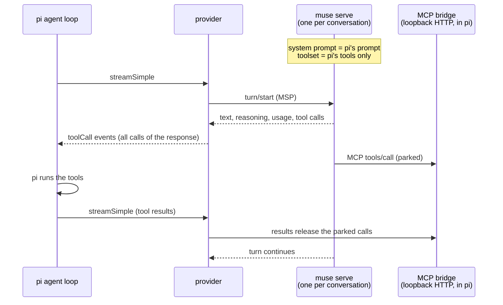

# pi-muse-subscription

Use your **Muse Code subscription** in [pi](https://pi.dev). This pi provider runs Meta's Muse
models (Muse Spark, Muse Wonder) through the [Muse Code SDK](https://github.com/meta-models/muse-code-sdk)
and a local `muse serve` host, while pi keeps its own agent loop, tools, system prompt, compaction
and session tree. Muse Code serves only as the authenticated model transport.

```
pi install npm:pi-muse-subscription
# or: pi install git:github.com/jkeskikangas/pi-muse-subscription
/model muse-sdk/muse-spark-1.3
```

Requirements: pi ≥ 1.0, Node ≥ 20, and Muse Code ≥ 1.4.14 signed in with your subscription
(`brew install muse-code` or `curl -fsSL https://dev.meta.ai/install.sh | sh`, then `muse` → `/login`).

A Muse Code subscription key is accepted only from the Muse Code client. pi's built-in `meta`
provider calls the Model API directly, so with that key it fails with
`403 client_attestation_denied`. This provider sends every request through Muse Code itself.

## How it works



- **pi's prompt and tools, not Muse Code's.** Each host gets a private Muse Code config directory
  whose settings set `run.system_prompt` to pi's prompt and `run.toolset` to pi's tools, which a
  loopback MCP server serves. Muse Code's 48k-character system prompt, its 26 built-in tools,
  skill catalog, observer agents (goal, verify, skill, todo, memory, scope reminders: each one an
  extra model call per turn) and foreign rules are off. A request carries pi's prompt plus about
  2k characters of Muse Code context (workspace root, permission mode, memory index).
- **One live host per conversation.** pi's next provider call after a tool round delivers the tool
  results to the parked MCP calls, matched by the model's call id, and Muse Code continues the same
  turn. Muse Code runs a response's tool calls one at a time; the provider reads the whole set from
  the session's raw log as soon as the response is committed, so pi still runs them in parallel.
- **Steering is native.** A message you type while tools run goes in with `turn/steer` before the
  results are released, so the model sees it at that tool boundary.
- **Divergence resumes or forks Muse Code's own session.** Each completed turn is recorded in an
  anchor registry (pi transcript hash → Muse Code session and turn). After an abort, `/tree`
  navigation, a fork or a pi restart, the provider finds the longest recorded prefix and either
  resumes that session (when the turn is still its last clean one) or forks it at that turn with
  `session/fork`. Muse Code replays its own record, so nothing is re-sent as text.
- **Foreign history is carried as text.** Turns from other providers, a compacted session or a
  session from before the extension start a fresh Muse Code session whose first turn carries the
  earlier conversation in a `<conversation_history>` block.
- **One-shot requests**, such as compaction and branch summaries, run tool-less and unpersisted.
- **pi owns context.** Muse Code's own compaction is pushed to 99% of its window, and pi plans
  against a smaller window, so pi always compacts first. Tool calls never time out on the Muse Code
  side (`tool_timeout_sec` is a week); pi's own timeouts apply.

## Billing and privacy

- **Subscription only.** `META_API_KEY` is removed from Muse Code's environment: Muse Code prefers
  it over the account login, which would move every request to pay-as-you-go billing.
- **Contributor mode.** Muse Code subscriptions default to Contributor mode, where Meta may train on
  your prompts, code and outputs in exchange for more usage. This provider passes an explicit
  `--contributor-mode`: your saved Muse Code setting if you ever saved one, otherwise **off**.
  Override with `"contributorMode": "on"` in `muse-sdk.json` or `PI_MUSE_SDK_CONTRIBUTOR=on|off`.
- Requests identify as Muse Code SDK traffic: the user agent is Muse Code's, followed by
  `pi_muse_subscription/<version>`.
- Usage is reported in tokens; cost shows as 0 because the plan is flat-rate. Check your allowance
  with `muse usage`.

## System prompt

For `muse-sdk` models the extension replaces pi's default prompt prefix with one written for Muse
models. It lists the selected tools and keeps every tool and prompt guideline that pi and other
extensions contribute. pi's context files, skills and working directory are unchanged, and your own
`SYSTEM.md` always wins. Set `"promptMode": "pi"` in `muse-sdk.json`, or `PI_MUSE_SDK_PROMPT=pi`,
to keep pi's default prompt.

## Configuration

Optional `muse-sdk.json` in pi's agent directory (`~/.pi/agent`, or `$PI_CODING_AGENT_DIR`):

```json
{ "museBin": "/opt/homebrew/bin/muse", "maxSessions": 3, "idleMinutes": 20, "contributorMode": "off" }
```

A project's `.pi/muse-sdk.json` can set `maxSessions` and `idleMinutes` only: pi reads it before
project trust, so a project cannot choose which program runs or opt you into Contributor mode.
`PI_MUSE_SDK_MUSE_PATH` overrides the executable path.

- `PI_MUSE_SDK_DEBUG=/path/log`: routing decisions (`live` / `resume` / `fork` / `synth` / `fresh`).
- Thinking levels map one to one onto Muse reasoning efforts (`off` → `none`, … `max`). Levels a
  model does not offer are disabled.
- Models: a bundled snapshot (`muse-spark-1.3`, `muse-wonder-1.0`, `muse-spark-1.2`), replaced by
  Muse Code's live catalog for your plan once a pi session starts.
- Muse Code sessions are stored by Muse Code (`~/.local/share/muse`), so they also appear in
  `muse resume`.

## Experimental surface

The Muse Code SDK is a developer preview. Two things this provider relies on are not covered by its
stability promise:

- the raw session log (`rawLog` capability, experimental), used to hand pi all tool calls of a
  response at once. Without it the provider still works, but pi receives a response's calls one
  at a time;
- the settings keys for the system prompt, toolset, observers, skills and context slimming, which
  were found in Muse Code 1.4.14 rather than in its documentation. `@muse-code/sdk` is pinned to the
  same version; check `npm run test:host` after a Muse Code upgrade.

## Tests

- `npm test`: offline unit tests.
- `npm run test:host`: the provider against the installed `muse serve`, offline. A local fake
  serves Muse Code's model endpoint and records every request. It covers prompt and tool
  replacement, one request per turn, parallel tool calls, steering, restart resume, fork, foreign
  history, tool-less requests, abort recovery and the live catalog. `PI_MUSE_SDK_SLOW=1` adds a
  tool call parked for 6.5 minutes.
- `npm run test:e2e`: pi's own agent loop (`pi -p`) over the extension and `muse serve`, offline:
  the model reads a file through pi's `read` tool.
- `npm run test:live`: against Muse Code and Meta on your login (spends a few prompts).
